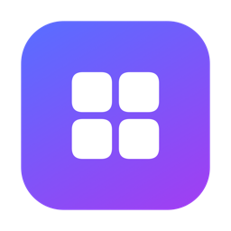
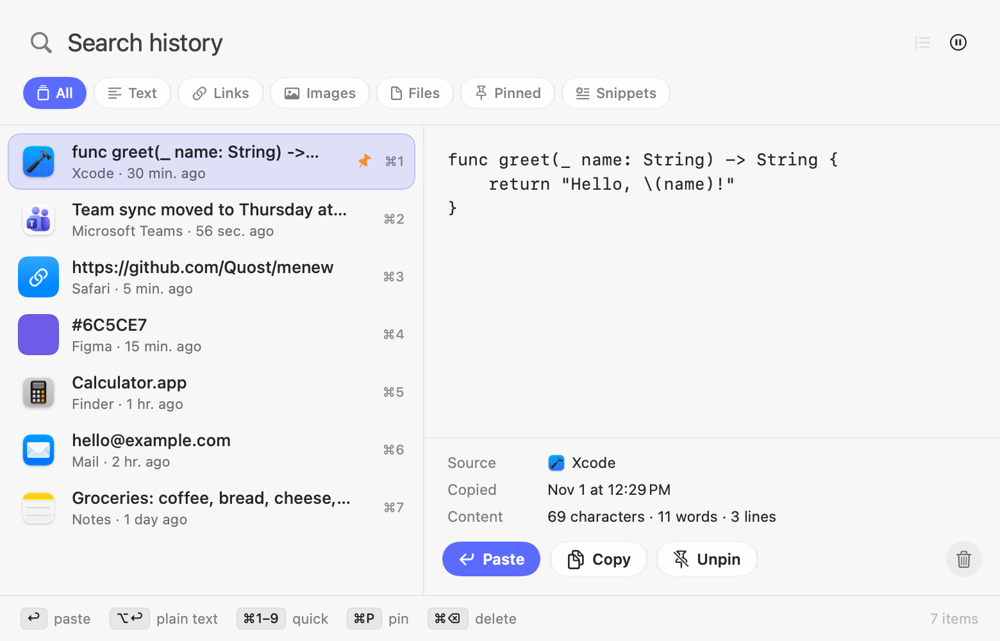
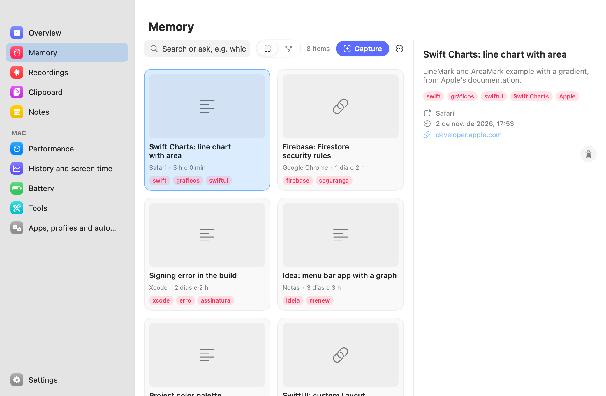
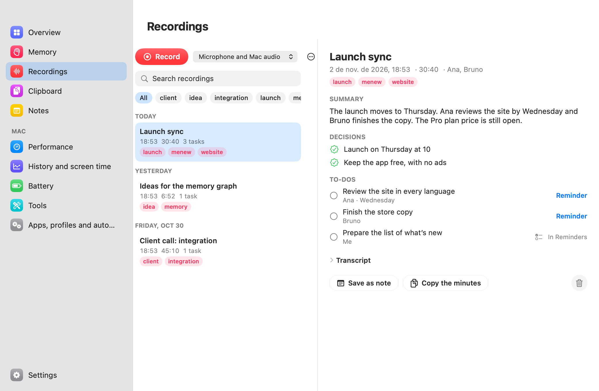
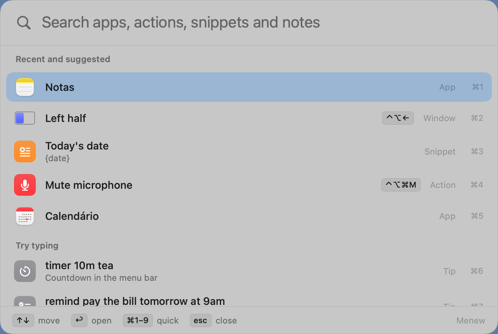
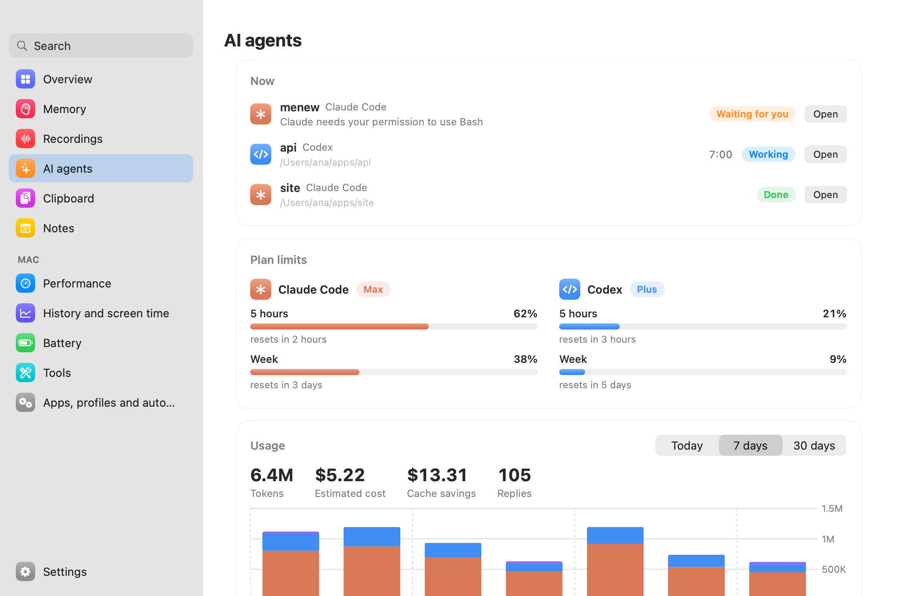
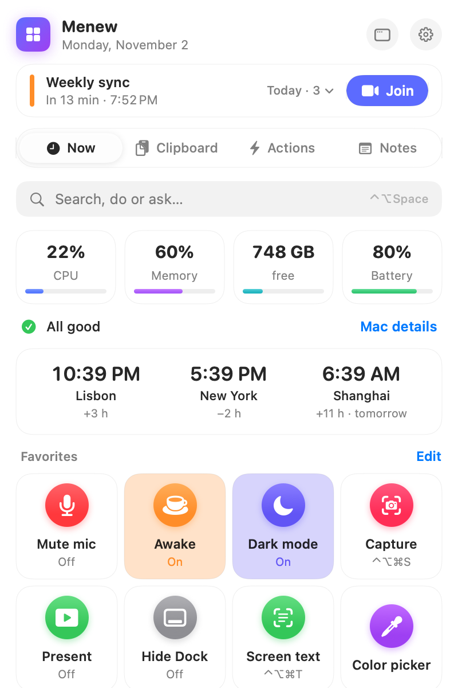
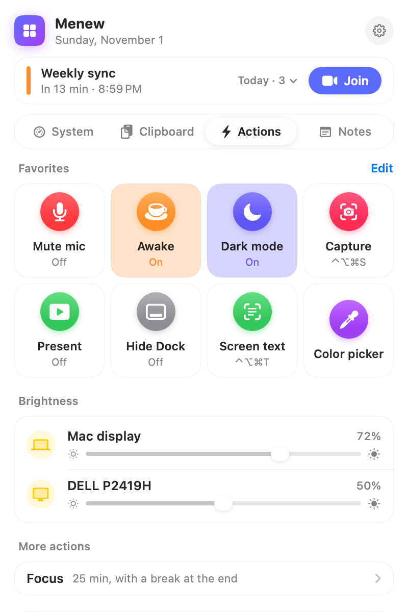
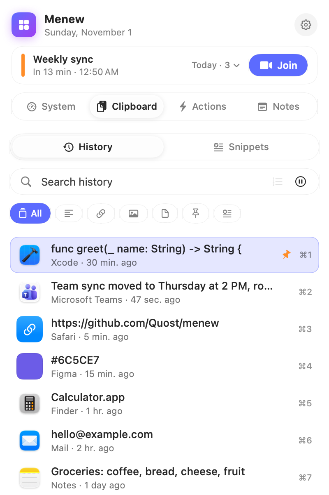

<p align="center">
  
</p>

<h1 align="center">Menew</h1>

<p align="center">
  <b>Your Mac's menu bar, supercharged.</b><br>
  Memory · Recordings with minutes · Command palette · Clipboard history · Windows · Screenshots · System monitor · On-device AI · AI agents<br>
  Free, open source, native. No account, no telemetry.
</p>

<p align="center">
  <a href="https://github.com/Quost/menew/releases/latest"></a>
  
  
  <a href="https://github.com/Quost/menew/actions/workflows/ci.yml"></a>
  <a href="LICENSE"></a>
  <a href="https://github.com/Quost/menew/stargazers"></a>
</p>

<p align="center">
  <a href="https://menew.web.app/?ref=github"><b>Website</b></a> ·
  <a href="https://github.com/Quost/menew/releases/latest/download/Menew.dmg"><b>Download</b></a> ·
  <a href="CONTRIBUTING.md"><b>Contribute</b></a>
</p>

<p align="center">
  <picture>
    <source media="(prefers-color-scheme: dark)" srcset="docs/assets/panel0-dark.png">
    
  </picture>
</p>

## Highlights

### 🧠 Memory — <kbd>⌃</kbd><kbd>⌥</kbd><kbd>⌘</kbd><kbd>K</kbd>

<p align="center">
  <picture>
    <source media="(prefers-color-scheme: dark)" srcset="docs/assets/hub-memory-dark.png">
    
  </picture>
</p>

Never lose what crossed your screen. Press ⌃⌥⌘K and pick an area or window: Menew keeps the image, reads the text and notes where it came from (app, window and the browser tab’s link). With Apple Intelligence it adds a title, a one-line summary, tags and the named things in it (tools, people, projects). Search it all in the Memory section or the palette, or save a copied text or image from the clipboard with one click. **Ask your memory** in plain words (“which was that charts library in Swift?”, or “remember …” in the palette): the Mac’s AI turns the question into search terms with synonyms and translations, looks through memory, notes and clipboard, and answers with numbered sources you can open. Memory items also show up in Spotlight. The **knowledge graph** view links the topics the AI found (tools, people, projects, tags) to your saved items and #tagged notes; click a topic to filter, click a dot to open the item. By default, copied captures from Menew (⌃⌥⌘S) are saved to Memory too. **Automatic Memory** (Settings › Clipboard, or the ⋯ menu in Memory) lets it grow by itself, each source with its own switch, all off by default: **every screenshot** copied or saved from any app (⌘⇧4, ⌘⇧5, CleanShot, Shottr), with its text read on your Mac; the **minutes of each recording** (topic, summary, decisions, to-dos and next steps, not the transcript); your **notes** (never protected or password notes; protect or delete one and it leaves Memory); and a **summary of each Claude Code, Codex and Gemini CLI session** (project, branch, request, what was done, files touched and commands run, never the whole transcript), read from the logs each tool keeps on your Mac and updated as the session goes on. Turning a source on brings in the last 30 days, without duplicates. Concealed clipboard items, screenshots taken with a password app in front, and API keys, tokens, passwords and private keys in transcripts and screenshot text are left out. Everything stays in a folder on your Mac.

### 🎙️ Recordings with minutes — <kbd>⌃</kbd><kbd>⌥</kbd><kbd>⌘</kbd><kbd>G</kbd>

<p align="center">
  <picture>
    <source media="(prefers-color-scheme: dark)" srcset="docs/assets/hub-recordings-dark.png">
    
  </picture>
</p>

Press ⌃⌥⌘G, or Record in the Now tab, to start and stop. Choose **Mac audio and microphone** (a call), **Mac audio only** (a video or a call where you only listen) or **microphone only** (ideas and voice notes); the shortcut uses your last choice. While recording there is only a small stop symbol in the menu bar, so nothing shows when you share your screen (hover the notch to see the time). The microphone and the Mac’s audio are saved separately, so the transcript knows what was **Me** and what was **Others**. Your Mac transcribes it offline and Apple Intelligence writes the minutes: a title, a summary, decisions, tasks with owner and due date, people and tags. Recordings are listed by date with search and tag filters, in the Menew window and as a **Recordings** folder at the top of Notes; send your tasks to Reminders (or have Menew do it for you), save the minutes as a note or copy them. The notch shows the recording time with a Stop button. In Settings › AI › About you, tell the AI your name, what people call you, who you work with and a glossary, so the minutes know which tasks are yours. Everything stays on your Mac. **Detailed minutes**: the whole transcript is read in parts, so even a long meeting gets its main topic, a summary, each topic discussed with what was actually said (facts, numbers, names, concerns), decisions, a task table with owner and due date, next steps and notes. Copy the minutes or save them as a note in Markdown; older recordings get the new format with Redo the minutes. The **Export** menu saves the audio as one light .m4a (both sides mixed) or a .zip with the audio and the minutes.

### ⌨️ Command palette — <kbd>⌃</kbd><kbd>⌥</kbd><kbd>Space</kbd>

<p align="center">
  <picture>
    <source media="(prefers-color-scheme: dark)" srcset="docs/assets/palette-dark.png">
    
  </picture>
</p>

Press <kbd>⌃</kbd><kbd>⌥</kbd><kbd>Space</kbd> anywhere to find and run any app, Menew action, window layout, snippet, note or copied item. Type “brightness 60” or “awake 2h”, and your recent picks come first. It also does math and conversions: “12*7.5”, “20% of 340”, “5 km to mi”, “72 f to c” and currencies like “100 usd to brl”. It also transforms the text you copied: UPPERCASE, lowercase, Title Case, camelCase, snake_case, kebab-case, remove accents, sort or dedupe lines, format or minify JSON, Base64 and URL encode/decode, and count characters and words, with a live preview. **Quick links**: “g coffee”, “gh menew”, “maps paulista”, “yt …”, “wiki …”, plus your own in Settings → Quick links (say “jira ABC-123” with `https://company.atlassian.net/browse/{q}`); a typed address like “github.com/quost” opens directly, and anything else can be searched on the web. They open in your browser. **On-device AI** (Apple Intelligence, macOS 26+): summarize, rewrite clearer, more formal, friendlier or shorter, or fix spelling and grammar in the copied text, using only the model on your Mac. **Offline translation** (macOS 15+, no Apple Intelligence needed): “translate english” (or Portuguese, Spanish, German, French, Italian, Japanese, Chinese) uses Apple's translator on your Mac. Start with “ai” (or “ia”, “ki”, “?”) to **ask anything**; the answer streams into a small window you can copy from. For developers: decode a JWT,**Emoji and symbols**: “emoji rocket”, “emoji coração” or “:fire” for emoji, and words like “arrow”, “degree”, “euro” or “check” for →, °, €, ✓ and more; ↩ pastes it. **Timers and alarms**: “timer 10m tea”, “timer 1h30” or “alarm 7:30 meeting”, with a countdown in the menu bar and a sound and notice on time. **Quick reminders**: “remind pay the bill tomorrow at 9” (or “lembrar …”, “erinnern …”, “recordar …”) creates it in the Reminders app, with the date understood from what you typed.  generate a UUID, copy the Unix timestamp or paste one to see the date. **Script commands**: drop your own scripts (shell, Python, Node, Ruby, AppleScript) in the scripts folder (“Open scripts folder” in the palette) and each one becomes a command; Raycast script headers (title, icon, mode, argument) work as they are. **Natural-language commands**: start with “do” (or “faz”, “mach”, “haz”) and describe what you want, like “do dark mode, mute the mic and open Zoom”; the Mac’s on-device AI picks the matching Menew actions, window layouts and apps, shows the steps and runs them only when you confirm. Nothing that deletes or quits is ever chosen.

### ✨ On-device AI

Settings › AI lists every AI feature with how to use it and a switch to turn it off (it then disappears from the palette, shortcuts and buttons), and shows whether Apple Intelligence is on for this Mac. Natural-language commands, Ask AI, summarize and rewrite copied text, ask about the screen, rewrite anywhere (⌃⌥⌘R), the slow-Mac explanation and note summaries use Apple’s on-device model; smart clipboard search, translation and transcription work without Apple Intelligence. Nothing is sent to the internet.

### 🤖 AI agents: Claude Code, Codex and Gemini CLI

<p align="center">
  <picture>
    <source media="(prefers-color-scheme: dark)" srcset="docs/assets/hub-agents-dark.png">
    
  </picture>
</p>

The **AI agents** section of the Menew window shows what your coding agents are doing. **Now**: every Claude Code, Codex and Gemini CLI session, with its project and whether it is working, done or **waiting for you** (a permission or a question); the notch shows “2 working” or “1 waiting for you” with an **Open** button that brings its terminal to the front; rest the pointer on the notch to see what each agent is doing right now (“Edit · session.ts”, “Bash · Run the tests”), how long it has been working, and today’s tokens, cost and limits (always there, even with no session open; a window that has already reset shows 0% and its next reset); and you get a notification when a request that took more than 20 seconds finishes. Turn it on per tool under Set up: Menew adds one command to that tool’s hooks (`~/.claude/settings.json`, `~/.codex/hooks.json`, `~/.gemini/settings.json`), keeps a `.menew-backup` copy and touches nothing else. **Plan limits**: the 5-hour and weekly windows with a bar, when each resets and, at the current pace, when you would run out, with alerts at 75% and 90%; Codex limits come from its own logs, and Claude’s are optional (see Privacy). **Usage**: tokens for today, 7, 30 or 90 days (a bar per day), 12 months (a bar per week) or all time (a bar per month), stacked by tool or combined, with the estimated cost at Anthropic API prices, what the prompt cache saved, and the top models, projects and apps (Claude Code in the terminal, the Claude desktop app or an IDE; Codex CLI or the Codex app), read from the logs each tool already keeps on your Mac. Claude Code deletes its logs after 30 days, so Menew keeps a small daily summary (tokens and cost per day, tool, app, model and project) in `~/Library/Application Support/Menew/agent-usage.json`; on first launch it reads everything the logs still have. Models loaded in **Ollama** or **LM Studio** show up with the memory they use.

**MCP server**: let your agents ask Menew. One switch adds Menew to Claude Code, Codex, Gemini CLI, Claude Desktop or Cursor (or copy the config for any other app); it runs on your Mac as `Menew --mcp`, with no network. Agents can search your Memory and notes (never protected or password notes), list recordings and read the minutes with tasks, check how the Mac is doing, see agent usage, and, with Menew open, save something to Memory, create a note or send you a notice in the notch. Each source has its own switch; the clipboard history is off unless you turn it on.

### ✂️ Selected text, anywhere — <kbd>⌃</kbd><kbd>⌥</kbd><kbd>⌘</kbd><kbd>R</kbd>

Select text in any app and press ⌃⌥⌘R: rewrite it (fix, clearer, more formal, friendlier, shorter, in English) and replace it in place, or **explain** it, **document the code**, **write tests** for it, list the **requests and deadlines** in a message (and turn them into reminders), **draft a reply** in the message’s language and tone, turn it into a **reminder** or a **calendar event** (the AI finds the title, date, time and place), a **note**, or save it to **memory**. Note and memory work without Apple Intelligence.

## Everything else

Click a feature to read the details.

### Everyday tools

<details>
<summary>📋 <b>Clipboard history</b> — Text, links, images and files with instant search, filters, pins and a rich preview.</summary>

Press **⌘⇧V** anywhere. Skips passwords and any app you pick to ignore, and you can pause it for 15 minutes or an hour. Copy the text inside any copied image with one click. **Paste queue**: turn it on, copy several things, then each <kbd>⌘</kbd><kbd>V</kbd> pastes the next one in the order you copied them; the count shows in the menu bar. **Smart actions**: copy a phone number, address, email, tracking code (Correios, UPS and other international codes), color or meeting link and the command palette (and the item's right-click menu) offers the right action: call or WhatsApp, open in Maps, write an email, track the package, copy the color as HEX/RGB/HSL or join the call. Search also finds **text inside copied screenshots and images**, read in the background on your Mac. **Smart search**: type what you remember, like “the hotel link from yesterday”, “that Xcode error” or “images from today”; Menew understands dates (today, yesterday, this week) and types (link, image, file) and matches word roots and synonyms with macOS’s own language model, no Apple Intelligence needed. Under **Passwords**, your passwords notes are one Touch ID away: ↩ pastes the password, ⌥↩ the username, and it's cleared from the clipboard after 30 seconds without entering the history.

</details>

<details>
<summary>✂️ <b>Snippets</b> — Saved texts with <code>{date}</code>, <code>{time}</code> and <code>{clipboard}</code> placeholders, right inside ⌘⇧V.</summary>

Give one an abbreviation like `;sig` and typing it in any app turns it into the text (optional, off by default; never in password fields). Variables: `{date}`, `{time}`, `{weekday}`, `{tomorrow}`, `{clipboard}`, `{cursor}` (where the cursor lands) and `{input:Name}` (asked in a small window before pasting).

</details>

<details>
<summary>📝 <b>Notes</b> — Many notes with #tags, search and Markdown (checklists included).</summary>

Protected notes live in the Keychain and open with Touch ID. With Apple Intelligence, a note's ⋯ menu can **summarize it** or **extract its to-dos** as a checklist, on your Mac. **Password notes** keep name and value rows with hidden values, an eye to reveal and a copy button; copied values are marked confidential (no clipboard history) and cleared after 30 seconds. Switch a note's type at any time.

</details>

<details>
<summary>📸 <b>Screenshots</b> — Press <b>⌃⌥⌘S</b> to capture an area (Space for a window) or the whole screen from the command palette.</summary>

Annotate with a pen, arrows, rectangles and text, blur sensitive data, then copy, save, drag into another app or **pin it floating on screen**. “Copy text” reads the text in it. **Ask about the screen**: select an area (an error, a chart, text in another language) and ask your Mac’s on-device AI to explain, summarize, translate or tell you what to do; without Apple Intelligence it still shows the recognized text to copy. **QR codes**: read one from the screen (the content is copied, links never open by themselves), or show a QR of the copied text, a link or your Wi-Fi so your phone can open or join it. **Screen recording**: record an area or the whole screen as video (.mov) or as a looping **GIF**; a floating Stop button stays out of the recording and the file lands on your Desktop. Right-click Record screen to add sound (microphone, Mac audio or both); with sound, the audio can also go to Recordings and become minutes with tasks. **Scrolling capture**: pick an area that scrolls and Menew scrolls it for you, joining everything into one long image you can annotate.

</details>

<details>
<summary>🪟 <b>Window manager</b> — Snap the front window to halves, corners, thirds or full screen with <kbd>⌃</kbd><kbd>⌥</kbd> shortcuts (the same as Rectangle) or from a grid in Actions.</summary>

Send it to the other display, or put it back the way it was. **Drag to snap**: drag a window to the left or right edge for a half, the top for full screen or a corner for a quarter; a preview shows where it lands (turns itself off when Rectangle or Magnet is running).

</details>

<details>
<summary>📥 <b>Quick shelf</b> — Shake files while you drag them and a shelf pops up next to the cursor.</summary>

Drop files, links, text or images there, then drag them all out together to another app or folder. Items are always copied, so the originals never move. Also from the right-click menu or the command palette. With photos on the shelf, its image menu converts them to JPG, PNG or HEIC, shrinks them in bulk (3000 to 800 px), rotates them, removes the background or location and metadata, or copies the text in all of them; results are new files next to the originals, ready to drag out. With PDFs, its PDF menu combines them, compresses them (the same “Reduce File Size” filter as Preview, keeping text selectable), rotates them, turns pages into PNG images, splits them into one PDF per page, extracts the text to a .txt (scanned pages are read on your Mac) or saves a password-protected copy; images can also be combined into one PDF. With audio or video files, **Transcribe** turns speech into text on your Mac (offline), saved as a note and copied.

</details>

<details>
<summary>⚡ <b>Quick actions</b> — Switches that show their live state: mute the microphone (<b>⌃⌥⌘M</b> from anywhere) or the sound, hide the Dock, dark mode, keep awake (for a while, until a set time or while an app is open), hidden files and desktop icons.</summary>

One-click actions: color picker, plain-text clipboard, lock screen, eject disks, empty trash. **Copy text from screen** (**⌃⌥⌘T**): select an area and its text goes to the clipboard, recognized on your Mac with no internet. **Rewrite anywhere** (**⌃⌥⌘R**): select text in any app (Mail, Slack, Notion…) and pick Fix, Clearer, More formal, Friendlier, Shorter or In English; the new text replaces the selection and your clipboard goes back to what it was, all with your Mac’s on-device AI. **Sound**: switch the output (AirPods, headphones, speakers, displays) and the microphone from Actions or the command palette. **Presentation mode**: hides desktop icons, keeps the Mac awake, pauses the clipboard and shows only the icon in the menu bar; turning it off undoes only what it changed.

</details>

<details>
<summary>🔆 <b>Display brightness</b> — A slider for every screen: the Mac's own display and external monitors over DDC/CI (Apple Silicon).</summary>

Monitors that don't accept DDC (often because of a USB-C adapter or hub) are dimmed by software instead, remembered per monitor. Optionally, external monitors **follow the Mac display** as it adapts to the room's light, each keeping the difference you set with its slider (switch right below the brightness sliders, or Settings › Windows and displays).

</details>

<details>
<summary>🍅 <b>Focus timer</b> — Start 25 minutes from Actions (or any length: type “focus 50” in the command palette) and the time left shows in the menu bar.</summary>

Optionally mute the mic, keep the Mac awake and pause the clipboard while you focus; when it ends, everything goes back the way it was, with a sound, a notification and a 5-minute break. Add 5 minutes or stop at any time.

</details>

<details>
<summary>📅 <b>Next meeting</b> — Your next meeting from the Calendar app at the top of the menu, with a countdown and a <b>Join</b> button that finds the Zoom, Meet, Teams or Webex link.</summary>

Optional reminder 1 minute before; click it to join. **Today · N** opens the day's agenda, and **Copy my free times** puts your free slots for the next 5 working days (within your working hours) on the clipboard, ready to send. Also from the command palette. Off by default.

</details>

<details>
<summary>🚪 <b>App control</b> — Quit all apps, quit everything but the one you're using, hide the rest, or force quit a frozen app, from Actions or the command palette.</summary>

Quitting is a normal request, so apps with unsaved work ask first, and a “Never quit” list keeps apps like Music or Zoom open. **Ports in use** lists the servers running on your Mac (node, Docker, databases) so you can stop one; type “port” or “3000” in the palette too.

</details>

<details>
<summary>🗂️ <b>Work profiles</b> — Save the apps you have open and where each window sits, then bring it all back with one click (or from the command palette).</summary>

A profile can also keep the Mac awake, mute the mic, switch to dark mode and hide everything else. It can also quit every other app first, for a clean work mode.

</details>

<details>
<summary>⚙️ <b>Automations</b> — “When X happens, do Y”: at a time on chosen days, when the charger is plugged in or out, when the battery drops below a level, when an app opens or quits, when a display connects, before a meeting starts, when a focus session starts or ends, when presentation mode turns on or off, or when the Mac wakes.</summary>

Actions: turn on a profile, keep awake, mute the mic, light/dark mode, brightness, pause the clipboard, open an app, quit all apps (say, when the battery drops to 5%) or run one of your Shortcuts. No scripts, a notice when a rule runs and a “Test now” button.

</details>

<details>
<summary>🗂️ <b>Organize files</b> — Pick a folder (Downloads by default): Menew reads each file (PDF and document text, images by OCR) and the Mac’s AI suggests a clear name and a folder, like “Invoice - Acme - 2026-10” in Invoices.</summary>

Screenshots, installers and archives are sorted by rule. Review and edit every name and folder before applying; files are only moved and renamed inside that folder, nothing is deleted, and Undo puts everything back. Without Apple Intelligence, files are sorted by type.

</details>

- 🧽 **Cleaning mode** — Lock the keyboard for 2 minutes while you wipe it, or black out every screen to spot smudges.

### Mac health

<details>
<summary>📊 <b>System monitor</b> — CPU, GPU, memory, disk, battery, network and sensors, with history, alerts and a “Why is my Mac slow?” diagnosis.</summary>

CPU and GPU with live graphs, memory pressure and swap, disk space and read/write speed, battery health, cycles and charger, a <b>battery health history</b> (how much health it lost and how many cycles you use a month, from one reading a day kept on your Mac), the battery of connected accessories (Magic Mouse, Keyboard, Trackpad and AirPods, left, right and case), a <b>history of the last 24 hours, 7 days and 30 days</b> of CPU, memory and battery with the apps that used the most of each, <b>temperatures in °C</b> (chip, SSD, battery and every sensor) and <b>fan speed</b>, <b>performance and efficiency cores</b> one by one, <b>power draw in watts</b> and real time remaining, <b>SSD health</b> (SMART), a <b>runaway app alert</b> and <b>Copy report</b> for support, <b>Wi-Fi details</b> (signal, noise, link speed, channel, band and Wi-Fi standard), <b>login and background items</b> (the launch agents and services apps installed, from the command palette), <b>Screen time</b> (off until you turn it on: time per app today, over 7 or 30 days, split into focus, neutral and distraction and by kind of app (Development, Office, Design, AI, Organizing, Communication, Browsing, Learning and reading, Utilities, Entertainment, Social media), with an hour-by-hour timeline; right-click an app to change its kind or how it counts, and choose how each kind counts; it counts only the front app while you are active and stays on your Mac), <b>“Why is my Mac slow?”</b> (checks memory, CPU, heat, disk, Low Power Mode and uptime, points at the apps to blame and, with Apple Intelligence, explains it in plain words; macOS system processes are never suggested for quitting), uptime, thermal state and the top processes (quit them in one click).

Pick what shows in the menu bar (CPU, CPU graph, memory, network, disk, battery, temperature) with a live preview, all in one icon or with **separate icons**, each opening its own panel with details and a chart of the last 24 hours with the apps that used the most. **World clocks** for the cities you work with sit at the top (Settings → World clocks), and the command palette converts times: “3pm ny to lisbon”, “15h em Lisboa”, “time in Tokyo”.

</details>

<details>
<summary>🔔 <b>Alerts</b> — Optional macOS notifications for a nearly full disk, low battery, critical memory pressure, CPU stuck above 90% or a Mac running hot.</summary>

**Custom rules**: build your own, like “CPU above 80% for 10 min”, “battery below 30%”, “chip above 90 °C” or “free space below 20 GB”.

</details>

<details>
<summary>🔋 <b>Battery care</b> — Without an admin password or a helper: alerts when the battery reaches 80, 85, 90 or 95% on the charger (unplugging then helps it last longer) and when it gets to 40 °C or more, plus a health history in the Battery card with the trend and cycles per month.</summary>

Turn the alerts on in Settings › Alerts. **Wear**, in the Menew window's Battery section, shows where the battery wears out: cycles per day over 30 days (100% drained = 1 cycle) with this week against the last, the hours of the day that drain it most, the apps that used the most battery, and what wears it without adding cycles (time at 35 °C or more, time plugged in above 95%, drops below 20%), with one tip for what weighed most.

</details>

<details>
<summary>🌐 <b>Internet</b> — Live download/upload, local and public IP, and a real speed test powered by macOS <code>networkQuality</code>.</summary>

**Apps using the network**: download and upload per app, read from macOS `nettop` only while you have the list open.

</details>

- 🎧 **Devices** — Battery levels for AirPods (left, right, case), Magic Mouse, Keyboard and Trackpad.

<details>
<summary>🧹 <b>Free up space</b> — Quick scan for caches, logs and developer junk; deep scan for old downloads, large files (over 250 MB) and duplicate files (identical copies, byte for byte; the oldest is kept as the original).</summary>

You review everything, and your files go to the Trash. **Uninstall apps**: drop an app (or pick one) and Menew finds the preferences, caches, containers, saved state and logs it left in your Library; review the list and everything goes to the Trash. macOS apps are never touched.

</details>

### Made for macOS

<details>
<summary>🟣 <b>Live notch</b> — What matters right now appears on both sides of the camera, one thing at a time: a meeting about to start with a Join button, screen recording with the time and a Stop button, a timer or focus countdown, a muted mic during a call, AI agents working or waiting for you, and Menew’s confirmations like “Copied”.</summary>

It disappears when there is nothing to show. Rest the pointer on the notch and it opens a panel with your next meeting (and Join), the focus or timer countdown and shortcuts (mute the mic, capture, clipboard, shelf, palette); drag files to the notch and drop them to keep them on the shelf. Settings › Notch has a live preview, a switch and a Test button for each alert, and how early meetings appear (1, 2 or 5 minutes). On Macs without a notch it can show as a pill at the top of the screen. **In a call** (any app using the microphone), the hover panel shows the time in the call and puts mute, **Record minutes** (Mac audio and microphone) and live captions first; otherwise its shortcuts are Capture, Memory, Clipboard and Shelf. Below the next meeting, a line shows the one after it. By default it only alerts you about meetings with a call link or other guests, so calendar blocks (lunch, a workout) stay quiet; the ✕ in the hover panel dismisses an alert once or silences that title for good.

</details>

<details>
<summary>🪟 <b>Menew window</b> — The menu bar shows what matters now; the <b>Menew window</b> has the depth, with a sidebar like System Settings: Overview (today’s agenda, Mac health, screen time and what you saved), Memory, Recordings, AI agents, Clipboard, Notes, Performance, History and screen time, Battery, Tools, Apps, profiles and automations, and Settings, with one search box that finds both sections and settings.</summary>

Open it from the window button in the menu or “Menew window” in the palette.

</details>

<details>
<summary>🧩 <b>Widgets</b> — Four widgets for the desktop and Notification Center, small or medium: System (CPU, memory, disk, battery, and a CPU chart of the last minute), Meetings (the next one with a live countdown and the rest of the day), Timers (focus and timers counting down live) and Screen time (today, split into focus and distraction, with your top apps).</summary>

Right-click the desktop › Edit Widgets › Menew. Click a widget to open Menew.

</details>

<details>
<summary>🗣️ <b>Siri, Shortcuts & Spotlight</b> — Menew's actions show up on their own, no setup: capture the screen, copy text from screen, mute the mic, keep awake, presentation mode, dark mode, start a focus timer, activate a work profile, create a note, open the clipboard history or the command palette.</summary>

Actions that return a result, to chain in your own Shortcuts: get a system metric (CPU, memory, free disk, battery, uptime), get the clipboard history, find notes and add to a note, rewrite or summarize text with on-device AI, translate text, transform text (case, JSON, Base64, URL), get text from an image, make a QR code, convert and shrink images (removing location), get the next meeting or join it, start a timer and get today's screen time. Say “Mute my microphone with Menew” or ask “How is my Mac in Menew” and Siri answers with CPU, memory, disk and battery. Your notes show up in Spotlight (⌘Space) and open in Menew (protected and password notes never do; turn it off in Settings › Privacy). Find the actions in Spotlight, or combine them in your own Shortcuts. In all five languages.

</details>

<details>
<summary>🔍 <b>Live Text & background removal</b> — In clipboard images and pinned screenshots, select text or click links, phone numbers and addresses right on the image, like in Photos.</summary>

Remove the background from a photo: from the shelf’s Images menu (any number of photos), from the command palette for the copied image (“remove background”), or with the Remove Background action in Shortcuts. The subject comes out as a PNG with a transparent background. Everything runs on your Mac (VisionKit and Vision).

</details>

<details>
<summary>📱 <b>Continuity Camera</b> — Take a photo, scan a document or draw a sketch on your iPhone or iPad and it lands in Menew: on the clipboard (Actions › From iPhone), on the shelf (saved in Downloads), or as text only (scanned pages are read on your Mac).</summary>

Also in the command palette (“iphone”, “scan text”). Uses macOS’s own Import from iPhone, so the photo goes straight from your phone to your Mac.

</details>

<details>
<summary>🌙 <b>Focus filters</b> — In System Settings › Focus › (a Focus) › Focus Filters › Menew, choose what changes while that Focus is on: pause the clipboard history, show only meetings in the notch, mute the mic, turn on presentation mode or activate a work profile.</summary>

When the Focus ends, Menew undoes only what it changed. Shortcut in Settings › General › Focus.

</details>

<details>
<summary>💬 <b>Live captions</b> — Your Mac’s audio (a call, a video) or the microphone becomes captions in a small floating window, and on macOS 26 they are translated as you go (Portuguese, English, Spanish, German, Chinese, French, Italian, Japanese).</summary>

Recognition and translation run on your Mac; nothing is recorded or sent. Actions › Live captions, or “captions” in the command palette.

</details>

- 🪟 **Liquid Glass** — Native macOS 26 design: glass tabs, search, filters and buttons, with a translucent fallback on macOS 14 and 15.

<details>
<summary>🧩 <b>Only what you need</b> — A short welcome tour on first launch helps you set things up.</summary>

The menu opens on **Now**: a search box for the command palette, CPU, memory, disk and battery in one row with an “All good” or what needs attention, running timers, world clocks and your favorites; **Mac details** has every system card (reorder, fold or hide them). **Actions** has your **Favorites** on top and everything else in six groups (Screen and capture, Windows and displays, Sound and focus, Files and iPhone, AI on your Mac, System and cleanup), each opening its own page, and **Settings live in the Menew window** (the last item of its sidebar), with one search for sections and settings. Turn off Clipboard, Actions or Notes in Settings → General and they disappear completely (with Clipboard off, Menew doesn't even read it). Settings → Backup saves your settings, shortcuts, snippets, profiles and automations to a `.menew` file (notes and clipboard history optional) to restore later or on another Mac.

</details>

<details>
<summary>🌍 <b>5 languages</b> — English, Português, Deutsch, Español and 中文.</summary>

Follows your Mac, or pick one in Settings.

</details>

<p align="center">
  <picture>
    <source media="(prefers-color-scheme: dark)" srcset="docs/assets/popover-now-dark.png">
    
  </picture>
  &nbsp;
  <picture>
    <source media="(prefers-color-scheme: dark)" srcset="docs/assets/popover-actions-dark.png">
    
  </picture>
  &nbsp;
  <picture>
    <source media="(prefers-color-scheme: dark)" srcset="docs/assets/popover-clipboard-dark.png">
    
  </picture>
</p>


## Install

**Homebrew:**

```bash
brew tap quost/menew https://github.com/Quost/menew
brew trust quost/menew
brew install --cask menew
```

Or **download** the latest [`Menew.dmg`](https://github.com/Quost/menew/releases/latest/download/Menew.dmg), open it and drag Menew to Applications.

Or **build from source** (needs Xcode 16+ or the Swift toolchain):

```bash
git clone https://github.com/Quost/menew
cd menew
./build.sh --install
```

### Permissions

| Permission | Why |
|---|---|
| **Accessibility** | Paste automatically after picking a clipboard item, expand snippet abbreviations as you type, advance the paste queue on ⌘V, and block keys in cleaning mode. Optional. |
| **Screen & System Audio Recording** | Screenshots and copying text from the screen. Asked the first time you capture; images stay on your Mac. |
| **Microphone** | Recordings and live captions from the microphone. Asked the first time you record. |
| **Speech Recognition** | Transcribe recordings and captions on macOS 14 and 15 (macOS 26 transcribes without asking). |
| **Reminders** | Create the reminders you type in the command palette. Only asked the first time you use it. |
| **Calendars** | Show your next meeting with a Join button. Only asked if you turn it on in Settings → Calendar; read on your Mac, never uploaded. |
| **Automation** (Finder, System Events) | Empty the trash and toggle dark mode. Asked the first time you use them. |

## One app instead of many

Menew covers the everyday features of these popular Mac utilities in one free, native app. Keep using them if you need their advanced features.

| Instead of | Menew gives you |
|---|---|
| Raycast · Alfred | Command palette: apps, actions, math, conversions, quick links and AI (⌃⌥Space). |
| Maccy · Paste | Clipboard history with search, preview, snippets and a paste queue (⌘⇧V). |
| Rectangle · Magnet | Snap windows to halves, corners and thirds with the same ⌃⌥ shortcuts. |
| iStat Menus · Stats | CPU, GPU, memory, disk, network and battery in the menu bar. |
| CleanShot X | Screenshots with arrows, text, blur and pinning on screen (⌃⌥⌘S). |
| Amphetamine · Caffeine | Keep the Mac awake for a while, until a time or while an app is open. |
| CleanMyMac | Disk cleaner for caches, logs, big files and duplicates, plus an app uninstaller with leftovers; files go to the Trash. |
| Dropover · Yoink | A shelf for dragging files between apps, plus image and PDF tools. |
| ccusage · usage widgets | Claude Code, Codex and Gemini CLI usage, plan limits and who is waiting for you, plus an MCP server for your notes and minutes. |
| Granola · Otter | Meeting recordings with transcript, minutes and tasks, made on your Mac (⌃⌥⌘G). |
| TextSniper | Copy text from anywhere on screen, even from videos and images (⌃⌥⌘T). |
| PopClip | Actions on selected text in any app: rewrite, explain, reply, or turn it into a reminder or event (⌃⌥⌘R). |
| Hazel | Tidy a folder like Downloads: names and folders suggested from each file's content, with review and undo. |

Detailed comparisons, including where the specialized apps go further: [Raycast](https://menew.web.app/vs/raycast) · [Maccy and Paste](https://menew.web.app/vs/maccy) · [Rectangle and Magnet](https://menew.web.app/vs/rectangle) · [iStat Menus and Stats](https://menew.web.app/vs/istat-menus) · [CleanShot X](https://menew.web.app/vs/cleanshot) · [Otter and Granola](https://menew.web.app/vs/otter).

<sub>Names are trademarks of their owners and appear only for comparison. Menew isn't affiliated with or endorsed by any of them.</sub>

## Keyboard shortcuts

| Shortcut | Action |
|---|---|
| <kbd>⌃</kbd> <kbd>⌥</kbd> <kbd>Space</kbd> | Open the command palette (customizable) |
| <kbd>⌘</kbd> <kbd>⇧</kbd> <kbd>V</kbd> | Open clipboard history (customizable) |
| <kbd>⌥</kbd> <kbd>⌘</kbd> <kbd>M</kbd> | Open the Menew menu (customizable) |
| <kbd>⌃</kbd> <kbd>⌥</kbd> <kbd>⌘</kbd> <kbd>M</kbd> | Mute / unmute the microphone (customizable) |
| <kbd>⌃</kbd> <kbd>⌥</kbd> <kbd>⌘</kbd> <kbd>T</kbd> | Copy text from screen (customizable) |
| <kbd>⌃</kbd> <kbd>⌥</kbd> <kbd>⌘</kbd> <kbd>S</kbd> | Capture the screen and annotate (customizable) |
| <kbd>⌃</kbd> <kbd>⌥</kbd> <kbd>⌘</kbd> <kbd>R</kbd> | Rewrite the selected text with on-device AI, in any app (customizable) |
| <kbd>⌃</kbd> <kbd>⌥</kbd> <kbd>⌘</kbd> <kbd>K</kbd> | Save what's on screen to Memory (customizable) |
| <kbd>⌃</kbd> <kbd>⌥</kbd> <kbd>⌘</kbd> <kbd>G</kbd> | Start / stop a recording (customizable) |
| <kbd>⌃</kbd> <kbd>⌥</kbd> <kbd>←</kbd> <kbd>→</kbd> <kbd>↑</kbd> <kbd>↓</kbd> | Snap the window to a half |
| <kbd>⌃</kbd> <kbd>⌥</kbd> <kbd>U</kbd> <kbd>I</kbd> <kbd>J</kbd> <kbd>K</kbd> | Snap to a corner |
| <kbd>⌃</kbd> <kbd>⌥</kbd> <kbd>D</kbd> <kbd>F</kbd> <kbd>G</kbd> / <kbd>E</kbd> <kbd>T</kbd> | Thirds / two thirds |
| <kbd>⌃</kbd> <kbd>⌥</kbd> <kbd>↩</kbd> / <kbd>C</kbd> / <kbd>⌫</kbd> | Maximize / center / restore |
| <kbd>⌃</kbd> <kbd>⌥</kbd> <kbd>⌘</kbd> <kbd>→</kbd> | Move the window to the next display |
| <kbd>↩</kbd> / <kbd>⌥</kbd> <kbd>↩</kbd> | Paste / paste as plain text |
| <kbd>⌘</kbd> <kbd>1</kbd>…<kbd>9</kbd> | Quick paste |
| <kbd>⇥</kbd> | Next filter |
| <kbd>⌘</kbd> <kbd>P</kbd> / <kbd>⌘</kbd> <kbd>⌫</kbd> | Pin / delete |

## Performance

Menew only reads what it shows. With the menu closed it uses about **0.5% CPU, 19 MB of memory and 14 wakeups per second** on an Apple Silicon Mac (measured over 50 seconds with `top` and `footprint`, menu bar showing CPU, RAM and disk). GPU, disk activity, charts and the process list are only read while the menu is open, and timers let macOS batch their wakeups with other apps to save battery. The app is about 6 MB on Apple Silicon.

## Privacy

The app has **no telemetry, no analytics and no account**. Clipboard history and notes are stored locally in `~/Library/Application Support/Menew`. Items marked as passwords by password managers (`org.nspasteboard.ConcealedType`) are never saved. Values copied from password notes are marked the same way and cleared from the clipboard after 30 seconds. Backups are files you save yourself; protected notes are never included in them. The only network calls are the ones you can see: your public IP (`api.ipify.org`), the speed test you start yourself, a currency rate when you press ↩ on a conversion in the command palette (`api.frankfurter.app`, European Central Bank data), and a daily update check against this repo's releases (you can turn it off). Text recognition (copy text from screen or images) uses Apple's Vision framework on your Mac; nothing is uploaded, and the screen capture is deleted right after. AI text actions use only Apple's on-device model (never Private Cloud Compute), so the text stays on your Mac. The next meeting is read from the Calendar app through EventKit, only if you turn it on, and stays on your Mac. Notes you can search in Spotlight are indexed by macOS on your Mac (never protected or password notes, never the clipboard history). Live captions listen only while they are on and never record; speech is recognized and translated on your Mac. Recordings only happen when you start them; the audio, transcript and minutes are kept in `~/Library/Application Support/Menew/recordings`. Memory captures are only taken when you press the shortcut and are kept in `~/Library/Application Support/Menew/memory`; Automatic Memory is off until you turn on a source, reads screenshots, recordings, notes and agent logs on your Mac only (no network) and strips keys and tokens before saving. Widgets read a small file Menew rewrites every minute in its own shared container (`~/Library/Group Containers/9527N6XKKW.com.matheusquost.menew`); they run sandboxed and have no network access. AI agents: usage is read from the logs Claude Code, Codex and Gemini CLI already keep on your Mac (`~/.claude`, `~/.codex`, `~/.gemini`), and the daily totals for the long-term charts stay in `~/Library/Application Support/Menew/agent-usage.json` (no prompts or transcripts); agent hooks and the MCP server talk to Menew through local macOS notifications, and loaded Ollama and LM Studio models are read from their local ports (`127.0.0.1`). The one optional network call here is **Claude limits**, off by default: when you turn it on, Menew reads your Claude Code login from the Keychain (macOS asks first) and checks `api.anthropic.com` every 5 minutes for the 5-hour and weekly usage; nothing else is sent.

The website ([menew.web.app](https://menew.web.app/?ref=github)) counts visits and button clicks with [GoatCounter](https://www.goatcounter.com), which uses no cookies and stores no personal data. The app itself never does this.

## FAQ

**Is Menew really free?**  
Yes. Menew is free and open source under the GPL-3.0 license: no ads, no subscription, no paid tier. Anyone can read, change and share the code, and any version they distribute must stay open source too. If it helps you, you can buy the author a coffee, but nothing in the app asks for it.

**Does Menew collect my data?**  
No. There is no telemetry, no analytics and no account. Clipboard history and notes stay on your Mac. The only network calls are the update check, your public IP, a speed test you start, a currency rate you ask for and, only if you turn it on, your Claude plan limits. AI features use Apple's on-device model only.

**Which Macs does it run on?**  
macOS 14 Sonoma or later, on Apple Silicon and Intel. The AI features need macOS 26 or later with Apple Intelligence turned on.

**How do I install it?**  
Download the DMG and drag Menew to Applications, or use Homebrew: brew install --cask menew after adding the quost/menew tap. Updates arrive automatically.

**Is it safe to install?**  
Menew is signed with an Apple Developer ID and notarized by Apple, and all of its source code is public on GitHub.

**Can I turn off the parts I don't use?**  
Yes. In Settings → Modules you can turn off Clipboard, Actions or Notes, and they disappear completely. With Clipboard off, Menew doesn't even read it.

**Can Menew record meetings and write the minutes?**  
Yes. Press ⌃⌥⌘G (or Record in the Now tab) and choose Mac audio and microphone, Mac audio only, or microphone only. Your Mac transcribes it, tells you apart from the others, and Apple’s on-device AI writes a summary, decisions and tasks you can send to Reminders. No bot joins the call, nothing is uploaded, and short or empty recordings don’t get invented minutes.

**Is there a free, private alternative to Granola or Otter on the Mac?**  
Menew’s Recordings cover the everyday part: transcript, minutes and tasks, made on your Mac with Apple’s model, free and without an account. Granola and Otter go further with team sharing and cloud integrations.

**How do I find something I saw on screen later?**  
When you see it, press ⌃⌥⌘K to save it to Memory: Menew keeps the image, reads the text and notes the app and link. Later, search or ask in plain words, like “which was that Swift chart library?”, and the on-device AI answers with the saved items as sources. Memory items also show up in Spotlight.

## Roadmap

Recently shipped:

- [x] AI agent usage history: 90 days, 12 months and all time, per tool and per app
- [x] Automatic Memory: every screenshot, recording minutes, notes and a summary of each Claude Code, Codex and Gemini CLI session
- [x] AI agents: Claude Code, Codex and Gemini CLI usage, limits, notch alerts and an MCP server
- [x] Knowledge graph of memory and notes
- [x] Recordings with transcript, AI minutes, tasks to Reminders and About you
- [x] Actions on selected text: explain, document, tests, reminder, event, note, memory
- [x] Organize files by content, with review and undo
- [x] Messages: requests and deadlines to reminders, reply drafts
- [x] Screen recording with sound, transcribed into Recordings
- [x] Battery wear: cycles per day, draining hours and apps, heat and full-charge time

<details>
<summary>Everything shipped before (79 items)</summary>

- [x] Disk cleaner (quick and deep scans)
- [x] Custom keyboard shortcuts
- [x] Text snippets
- [x] Auto-delete clipboard items older than X days
- [x] Auto-updates with Sparkle
- [x] Homebrew cask
- [x] Memory pressure, battery health, alerts and a customizable menu bar
- [x] Optional modules and a first-launch tour
- [x] Window manager
- [x] Command palette
- [x] Work profiles (apps + saved window layouts)
- [x] Keep awake until a time or while an app is open, timed clipboard pause, heat alerts
- [x] Quick shelf for dragging files between apps
- [x] Simple automations (time, power and app triggers)
- [x] Calculator and unit conversions in the command palette
- [x] Copy text from the screen and from images (OCR, on device)
- [x] Text expander (snippet abbreviations)
- [x] Next meeting with a Join button
- [x] Focus timer
- [x] Text transforms in the command palette
- [x] Paste queue
- [x] Duplicate files in the cleaner
- [x] Network usage per app
- [x] App control (quit all, quit others, force quit)
- [x] Automations: meeting, focus and wake triggers, run a Shortcut
- [x] Password notes and switchable note types
- [x] Settings backup (export and restore)
- [x] Screenshots with annotations, blur and pinning
- [x] Sound output and microphone switcher, presentation mode
- [x] Developer kit: ports in use, UUID, timestamps, JWT
- [x] Image tools on the shelf (convert, shrink, strip metadata)
- [x] PDF tools on the shelf (combine, compress, rotate, pages to images)
- [x] Quick links and web search in the command palette
- [x] Today's agenda and “copy my free times”
- [x] Ask AI in the command palette, AI summaries and to-dos in notes
- [x] Smart clipboard actions (phone, address, email, tracking, color, meeting link)
- [x] World clocks and time zone conversion
- [x] Siri, Shortcuts and Spotlight actions
- [x] On-device AI text actions (summarize, rewrite, fix, translate)
- [x] QR codes: read from the screen, generate for text, links and Wi-Fi
- [x] Accessory batteries (Magic Mouse, Keyboard, Trackpad, AirPods) with low-battery alerts
- [x] Quick reminders from the command palette
- [x] Emoji and symbols in the command palette
- [x] Offline translation with Apple's translator
- [x] Transcribe audio and video on the shelf
- [x] Snippets with variables, fields and cursor position
- [x] Search text inside clipboard images
- [x] 24-hour system history and battery usage by app
- [x] Timers and alarms from the command palette
- [x] New layout: favorites, foldable sections, Settings window with search
- [x] Advanced monitor: P/E cores, watts, SSD health, runaway app alert, system report
- [x] Temperatures in °C and fan speed
- [x] Separate menu bar icons with their own panels
- [x] Drag windows to screen edges and corners to snap them
- [x] 7- and 30-day history and custom alert rules
- [x] Screen recording, GIFs and scrolling capture
- [x] App uninstaller that also removes leftovers
- [x] Script commands in the palette (Raycast-compatible)
- [x] Wi-Fi details and login/background items
- [x] Natural-language commands with on-device AI
- [x] “Why is my Mac slow?” diagnosis and sharing clipboard items
- [x] Smart clipboard search by meaning, date and type
- [x] Ask about the screen with on-device AI
- [x] Rewrite selected text in any app with on-device AI
- [x] Screen time with focus and distraction
- [x] Live alerts in the notch
- [x] Settings › Notch (preview, per-alert switches) and Settings split into Keyboard shortcuts and Windows and displays
- [x] Widgets: system, meetings, timers and screen time
- [x] Shortcuts actions that return results (system, clipboard, notes, AI, translate, images, meetings, timers, screen time)
- [x] Notes in Spotlight, “How is my Mac” for Siri and an Open Note action
- [x] Live Text in images and background removal
- [x] Continuity Camera: photos, scans and sketches from iPhone to the clipboard, shelf or text
- [x] Notch panel on hover and drop files on the notch
- [x] Focus filters (pause clipboard, quiet notch, mute mic, presentation mode, work profile)
- [x] More PDF and image tools: split, extract text with OCR, password-protect, rotate images, copy text from images
- [x] Live captions of system audio or the microphone, translated on the Mac
- [x] Battery care: charge-level and heat alerts, health history
- [x] Menew window with a sidebar, and Memory (capture with source, OCR and AI tags)
- [x] Ask your memory in plain words, with sources, and memory in Spotlight

</details>

- [ ] Your idea here

Ideas? [Open an issue](https://github.com/Quost/menew/issues/new).

## Feedback

Found a bug or have an idea? Use **Report a problem…** or **Suggest an idea…** in Menew's right-click menu (or in Settings → Help). It opens a GitHub issue with your Menew and macOS versions already filled in.

## Contributing

Pull requests are very welcome. See [CONTRIBUTING.md](CONTRIBUTING.md) for how the project is organized and how to run it.

## Support

Menew is free and made in spare time. If it saves you a few minutes a day, a ⭐ on GitHub, a sponsorship or a coffee goes a long way.

<a href="https://github.com/sponsors/Quost"></a>
<a href="https://buymeacoffee.com/quost"></a>

## License

[GPL-3.0](LICENSE) © Matheus Quost.

The name “Menew”, the icon and the website are not part of the license: a fork needs its own name and icon. See [TRADEMARK.md](TRADEMARK.md).
