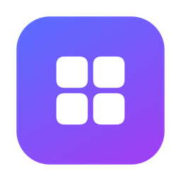
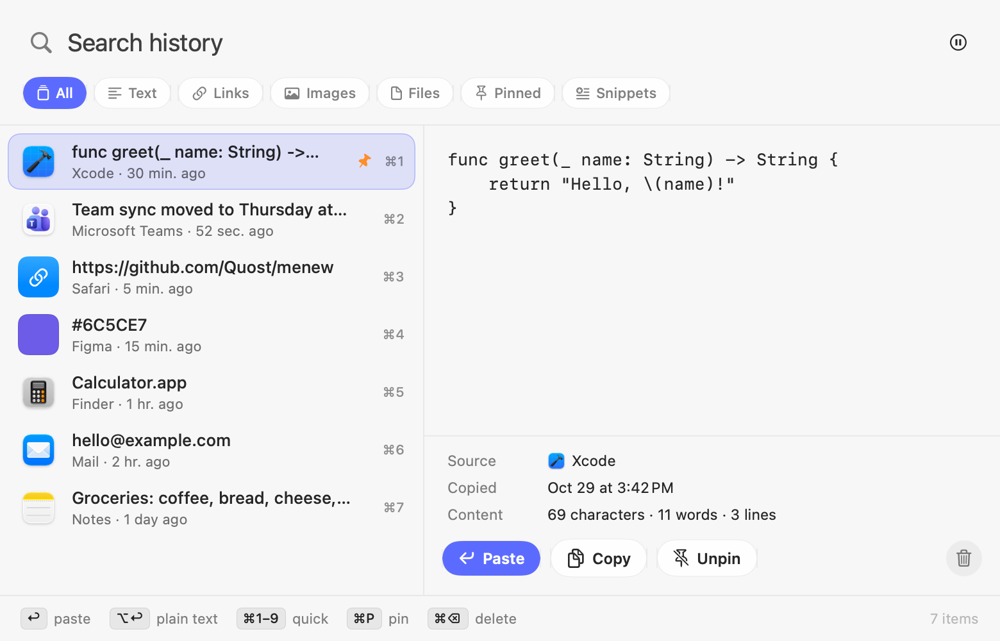
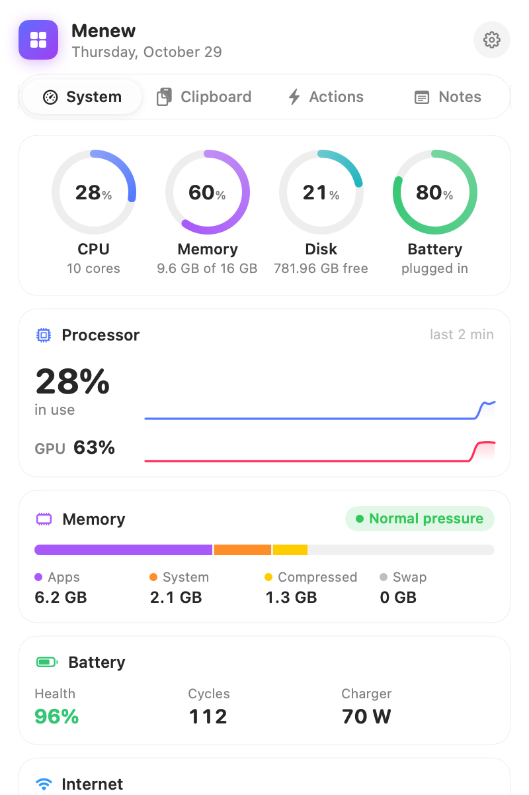
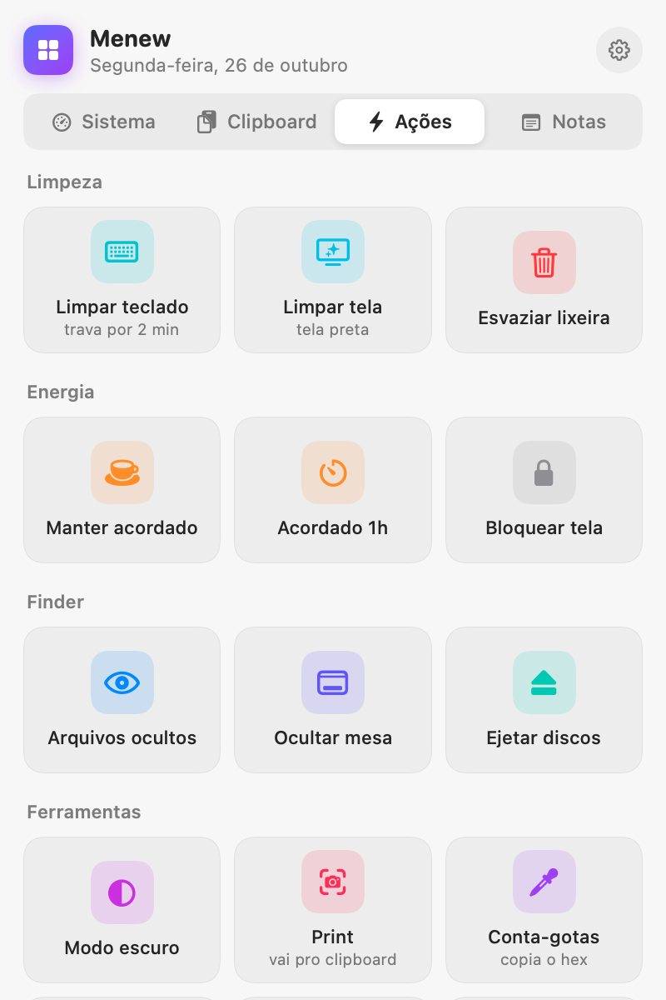
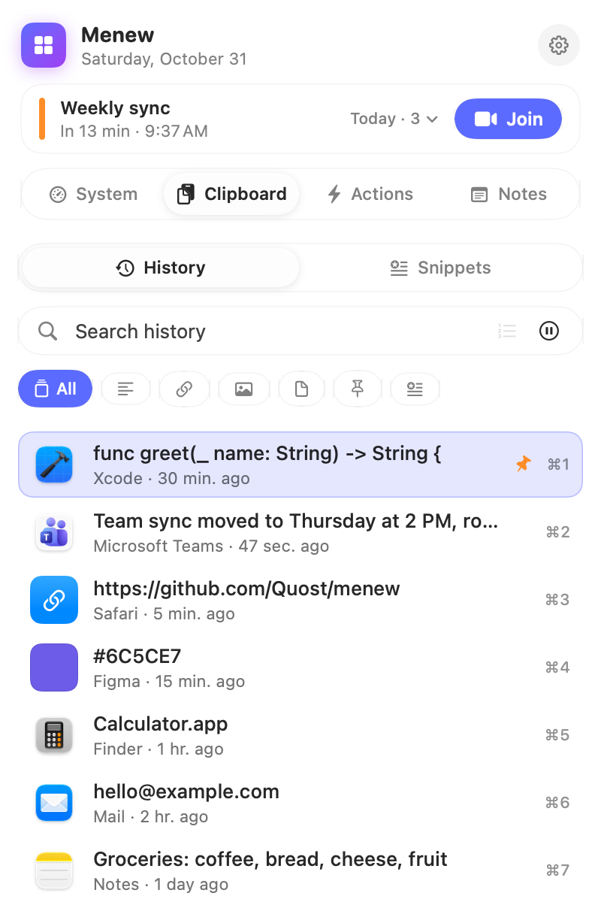
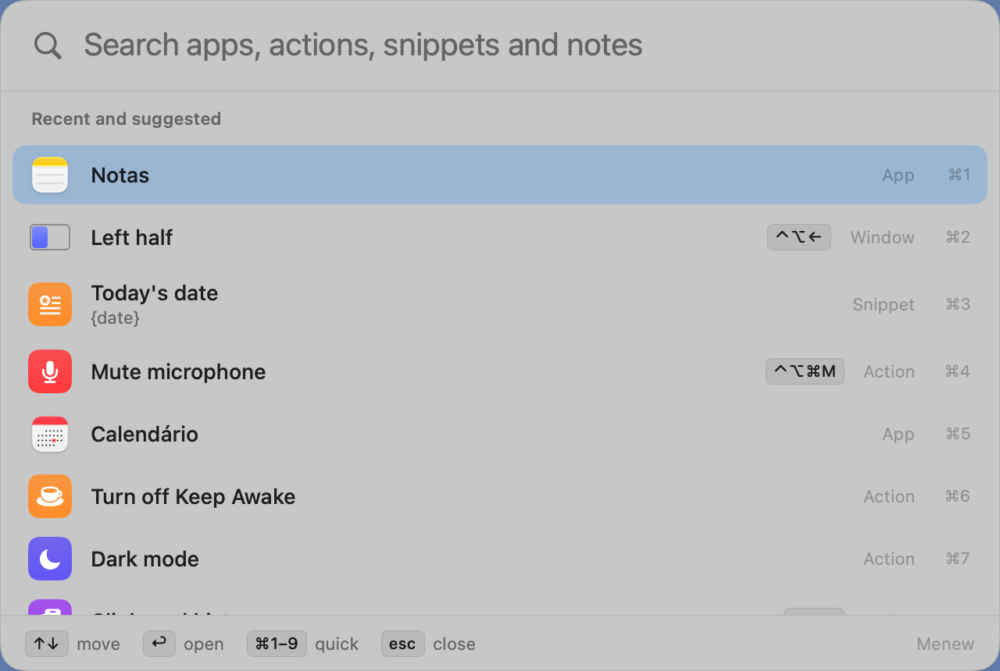

<p align="center">
  
</p>

<h1 align="center">Menew</h1>

<p align="center">
  <b>Your Mac's menu bar, supercharged.</b><br>
  Command palette · System monitor · Clipboard history · Quick actions<br>
  Free, open source, native. No account, no telemetry.
</p>

<p align="center">
  <a href="https://github.com/Quost/menew/releases/latest"></a>
  
  
  <a href="LICENSE"></a>
  <a href="https://github.com/Quost/menew/stargazers"></a>
</p>

<p align="center">
  <a href="https://menew.web.app/?ref=github"><b>Website</b></a> ·
  <a href="https://github.com/Quost/menew/releases/latest/download/Menew.dmg"><b>Download</b></a> ·
  <a href="CONTRIBUTING.md"><b>Contribute</b></a>
</p>

<p align="center">
  <picture>
    <source media="(prefers-color-scheme: dark)" srcset="docs/assets/panel0-dark.png">
    
  </picture>
</p>

## Features

| | |
|---|---|
| ⌨️ **Command palette** | Press <kbd>⌃</kbd><kbd>⌥</kbd><kbd>Space</kbd> anywhere to find and run any app, Menew action, window layout, snippet, note or copied item. Type “brightness 60” or “awake 2h”, and your recent picks come first. It also does math and conversions: “12*7.5”, “20% of 340”, “5 km to mi”, “72 f to c” and currencies like “100 usd to brl”. |
| 📊 **System monitor** | CPU and GPU with live graphs, memory pressure and swap, disk space and read/write speed, battery health, cycles and charger, uptime, thermal state and the top processes (quit them in one click). Pick what shows in the menu bar (CPU, CPU graph, memory, network, disk, battery) with a live preview. |
| 🔔 **Alerts** | Optional macOS notifications for a nearly full disk, low battery, critical memory pressure, CPU stuck above 90% or a Mac running hot. |
| 📋 **Clipboard history** | Text, links, images and files with instant search, filters, pins and a rich preview. Press **⌘⇧V** anywhere. Skips passwords and any app you pick to ignore, and you can pause it for 15 minutes or an hour. |
| 🔆 **Display brightness** | A slider for every screen: the Mac's own display and external monitors over DDC/CI (Apple Silicon). |
| ⚡ **Quick actions** | Switches that show their live state: mute the microphone (**⌃⌥⌘M** from anywhere) or the sound, hide the Dock, dark mode, keep awake (for a while, until a set time or while an app is open), hidden files and desktop icons. One-click actions: screenshot to clipboard, color picker, plain-text clipboard, lock screen, eject disks, empty trash. |
| 🪟 **Window manager** | Snap the front window to halves, corners, thirds or full screen with <kbd>⌃</kbd><kbd>⌥</kbd> shortcuts (the same as Rectangle) or from a grid in Actions. Send it to the other display, or put it back the way it was. |
| 🗂️ **Work profiles** | Save the apps you have open and where each window sits, then bring it all back with one click (or from the command palette). A profile can also keep the Mac awake, mute the mic, switch to dark mode and hide everything else. |
| 📥 **Quick shelf** | Shake files while you drag them and a shelf pops up next to the cursor. Drop files, links, text or images there, then drag them all out together to another app or folder. Items are always copied, so the originals never move. Also from the right-click menu or the command palette. |
| ⚙️ **Automations** | “When X happens, do Y”: at a time on chosen days, when the charger is plugged in or out, when the battery drops below a level, when an app opens or quits, or when a display connects. Actions: turn on a profile, keep awake, mute the mic, light/dark mode, brightness, pause the clipboard or open an app. No scripts, a notice when a rule runs and a “Test now” button. |
| 🧽 **Cleaning mode** | Lock the keyboard for 2 minutes while you wipe it, or black out every screen to spot smudges. |
| 🌐 **Internet** | Live download/upload, local and public IP, and a real speed test powered by macOS `networkQuality`. |
| 🎧 **Devices** | Battery levels for AirPods (left, right, case), Magic Mouse, Keyboard and Trackpad. |
| 🧹 **Free up space** | Quick scan for caches, logs and developer junk; deep scan for old downloads and large files. You review everything, and your files go to the Trash. |
| ✂️ **Snippets** | Saved texts with `{date}`, `{time}` and `{clipboard}` placeholders, right inside ⌘⇧V. |
| 📝 **Notes** | Many notes with #tags, search and Markdown (checklists included). Protected notes live in the Keychain and open with Touch ID. |
| 🧩 **Only what you need** | A short welcome tour on first launch helps you set things up. Turn off Clipboard, Actions or Notes in Settings → Modules and they disappear completely (with Clipboard off, Menew doesn't even read it). |
| 🪟 **Liquid Glass** | Native macOS 26 design: glass tabs, search, filters and buttons, with a translucent fallback on macOS 14 and 15. |
| 🌍 **5 languages** | English, Português, Deutsch, Español and 中文. Follows your Mac, or pick one in Settings. |

<p align="center">
  <picture>
    <source media="(prefers-color-scheme: dark)" srcset="docs/assets/popover-system-dark.png">
    
  </picture>
  &nbsp;
  <picture>
    <source media="(prefers-color-scheme: dark)" srcset="docs/assets/popover-actions-dark.png">
    
  </picture>
  &nbsp;
  <picture>
    <source media="(prefers-color-scheme: dark)" srcset="docs/assets/popover-clipboard-dark.png">
    
  </picture>
</p>

<p align="center">
  <picture>
    <source media="(prefers-color-scheme: dark)" srcset="docs/assets/palette-dark.png">
    
  </picture>
</p>

## Install

**Homebrew:**

```bash
brew tap quost/menew https://github.com/Quost/menew
brew trust quost/menew
brew install --cask menew
```

Or **download** the latest [`Menew.dmg`](https://github.com/Quost/menew/releases/latest/download/Menew.dmg), open it and drag Menew to Applications.

Or **build from source** (needs Xcode 16+ or the Swift toolchain):

```bash
git clone https://github.com/Quost/menew
cd menew
./build.sh --install
```

### Permissions

| Permission | Why |
|---|---|
| **Accessibility** | Paste automatically after picking a clipboard item, and block keys in cleaning mode. Optional. |
| **Automation** (Finder, System Events) | Empty the trash and toggle dark mode. Asked the first time you use them. |

## Keyboard shortcuts

| Shortcut | Action |
|---|---|
| <kbd>⌃</kbd> <kbd>⌥</kbd> <kbd>Space</kbd> | Open the command palette (customizable) |
| <kbd>⌘</kbd> <kbd>⇧</kbd> <kbd>V</kbd> | Open clipboard history (customizable) |
| <kbd>⌥</kbd> <kbd>⌘</kbd> <kbd>M</kbd> | Open the Menew menu (customizable) |
| <kbd>⌃</kbd> <kbd>⌥</kbd> <kbd>⌘</kbd> <kbd>M</kbd> | Mute / unmute the microphone (customizable) |
| <kbd>⌃</kbd> <kbd>⌥</kbd> <kbd>←</kbd> <kbd>→</kbd> <kbd>↑</kbd> <kbd>↓</kbd> | Snap the window to a half |
| <kbd>⌃</kbd> <kbd>⌥</kbd> <kbd>U</kbd> <kbd>I</kbd> <kbd>J</kbd> <kbd>K</kbd> | Snap to a corner |
| <kbd>⌃</kbd> <kbd>⌥</kbd> <kbd>D</kbd> <kbd>F</kbd> <kbd>G</kbd> / <kbd>E</kbd> <kbd>T</kbd> | Thirds / two thirds |
| <kbd>⌃</kbd> <kbd>⌥</kbd> <kbd>↩</kbd> / <kbd>C</kbd> / <kbd>⌫</kbd> | Maximize / center / restore |
| <kbd>⌃</kbd> <kbd>⌥</kbd> <kbd>⌘</kbd> <kbd>→</kbd> | Move the window to the next display |
| <kbd>↩</kbd> / <kbd>⌥</kbd> <kbd>↩</kbd> | Paste / paste as plain text |
| <kbd>⌘</kbd> <kbd>1</kbd>…<kbd>9</kbd> | Quick paste |
| <kbd>⇥</kbd> | Next filter |
| <kbd>⌘</kbd> <kbd>P</kbd> / <kbd>⌘</kbd> <kbd>⌫</kbd> | Pin / delete |

## Privacy

The app has **no telemetry, no analytics and no account**. Clipboard history and notes are stored locally in `~/Library/Application Support/Menew`. Items marked as passwords by password managers (`org.nspasteboard.ConcealedType`) are never saved. The only network calls are the ones you can see: your public IP (`api.ipify.org`), the speed test you start yourself, a currency rate when you press ↩ on a conversion in the command palette (`api.frankfurter.app`, European Central Bank data), and a daily update check against this repo's releases (you can turn it off).

The website ([menew.web.app](https://menew.web.app/?ref=github)) counts visits and button clicks with [GoatCounter](https://www.goatcounter.com), which uses no cookies and stores no personal data. The app itself never does this.

## Roadmap

- [x] Disk cleaner (quick and deep scans)
- [x] Custom keyboard shortcuts
- [x] Text snippets
- [x] Auto-delete clipboard items older than X days
- [x] Auto-updates with Sparkle
- [x] Homebrew cask
- [x] Memory pressure, battery health, alerts and a customizable menu bar
- [x] Optional modules and a first-launch tour
- [x] Window manager
- [x] Command palette
- [x] Work profiles (apps + saved window layouts)
- [x] Keep awake until a time or while an app is open, timed clipboard pause, heat alerts
- [x] Quick shelf for dragging files between apps
- [x] Simple automations (time, power and app triggers)
- [x] Calculator and unit conversions in the command palette
- [ ] Your idea here

Ideas? [Open an issue](https://github.com/Quost/menew/issues/new).

## Feedback

Found a bug or have an idea? Use **Report a problem…** or **Suggest an idea…** in Menew's right-click menu (or in Settings → Help). It opens a GitHub issue with your Menew and macOS versions already filled in.

## Contributing

Pull requests are very welcome. See [CONTRIBUTING.md](CONTRIBUTING.md) for how the project is organized and how to run it.

## Support

Menew is free and made in spare time. If it saves you a few minutes a day, a ⭐ on GitHub or a coffee goes a long way.

<a href="https://buymeacoffee.com/quost"></a>

## License

[MIT](LICENSE) © Matheus Quost
